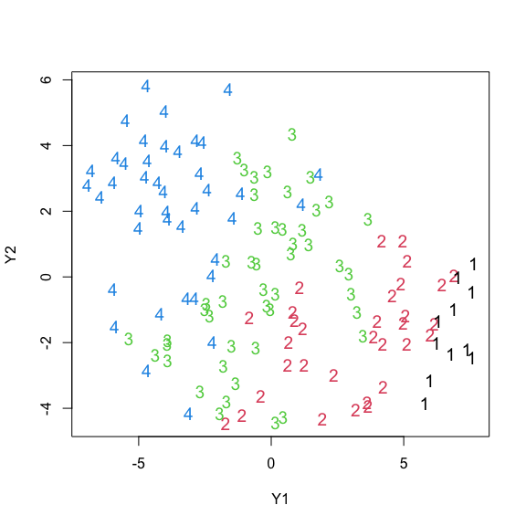
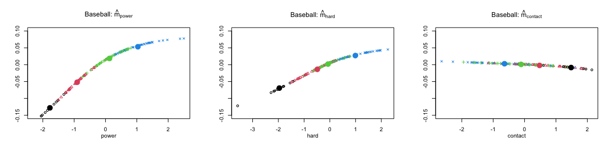

Sparse Monotone Clusters With Ordinal Interpretation (SMOCL)
================

R codes to implement Sparse MOnotone CLusters (SMOCL) with ordinal
interpretation.

#### Reference:

Chung, H.C., An, S., Cha, H., & Ahn, J. Monotone Clusters With Ordinal
Interpretation. *Statistical Analysis and Data Mining* (to appear)

## To run

To implement, (1) clone this repository; (2) open `SMOCL.Rproj`; (3)
load packages and function located in the folder `./Functions/` as
follows

## Simple example

This example uses Baseball data.

#### Load data

``` r
# Load data
mlb_data <- readRDS("./data/baseball.rds")
mlb_x <- mlb_data$x
```

#### Fit SMOCL with $`K=4`$.

``` r
K <- 4
lambda_seq <- seq.default(from=0.1,to=1,length=30)
mocl <- MOCL_wcss_scale(Xf = mlb_x, K = K, lambda_seq = lambda_seq, df=5, tol = 1e-10)
```

#### Cluster visualizaion using $`t`$-SNE.

``` r
set.seed(252)
tsne  <- Rtsne(mlb_x, dim=2,  perplexity=30, max_iter = 500)
plot(tsne$Y[,1],tsne$Y[,2], col = 0, xlab = "Y1", ylab="Y2" )
text(tsne$Y[,1],tsne$Y[,2], labels=mocl$cluster, col = mocl$cluster, cex=1.2 )
```

<!-- -->

#### Estimated monotone functions

``` r
group <-  mocl$cluster
fx <- mocl$fx
ylims <- c(-0.15,0.1)

sindx <- which( colSums(abs(fx)) != 0 )
dat <- mlb_x
var_names <- colnames(mlb_x)

par(mfrow=c(1,3))
for( jj in sindx){
  maintitle <- bquote(paste("Baseball: ", hat(m)[.( var_names[jj] )] )  )
  means <- group_means( xs = dat[,jj], ys = fx[,jj], group = group)
  plot(dat[,jj], fx[,jj], col = group, main = maintitle, 
       pch=group, cex=0.8, ylim = ylims, xlab = "", ylab = ""
  )
  title(xlab = var_names[jj], line = 2)
  points( means[,1], means[,2], col = 1:max(group), pch=20, cex=3)
}
```

<!-- -->
